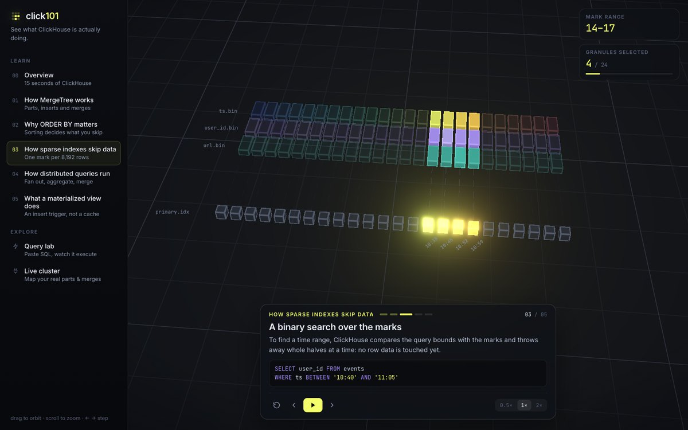
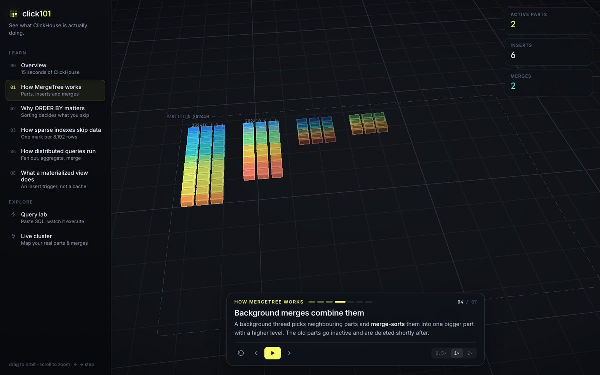
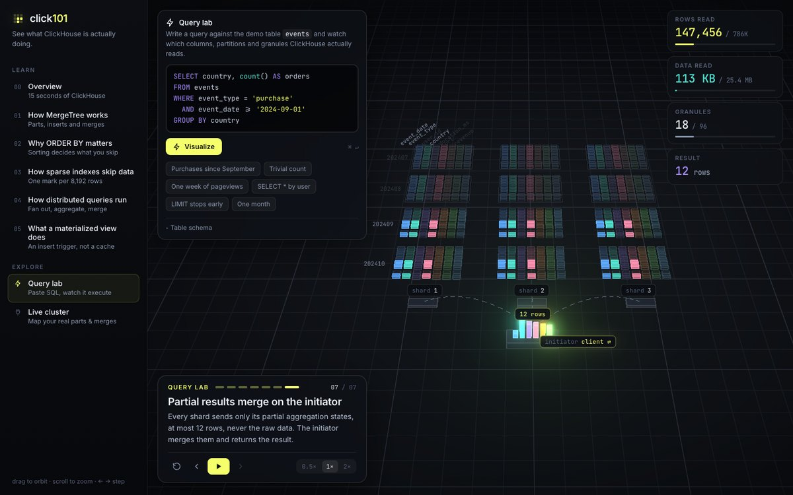
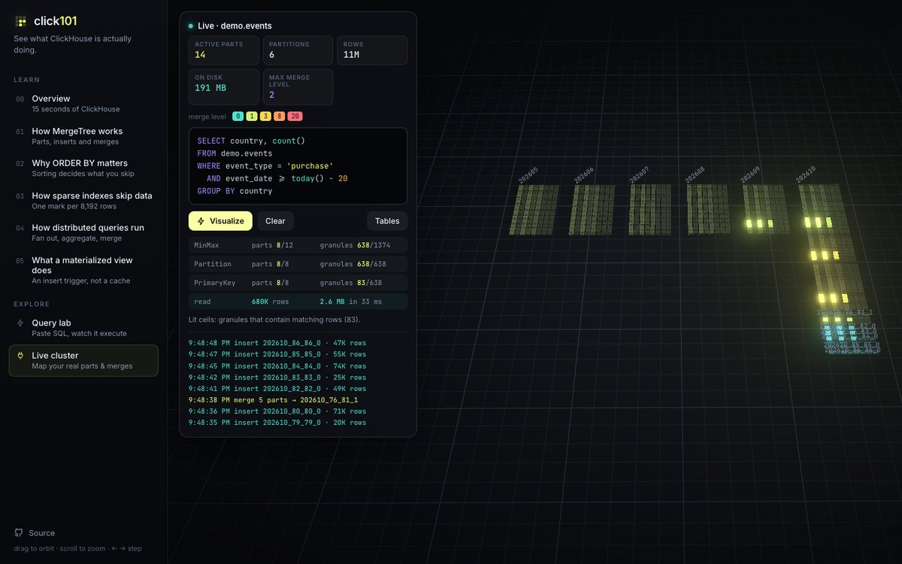

# granule

**See what ClickHouse is actually doing.**

<p align="center">
  
</p>

granule is a visual ClickHouse explorer that turns tables, parts, merges, indexes and queries into an animated system map. It isn't an admin panel or a monitoring dashboard. Think of it as ClickHouse, explained live.

Every box on screen is a **granule**: 8,192 rows of one column. Inserts drop new parts in, merges physically pull them together, filters dim what gets skipped, and distributed queries fan out and come back as partial states.

It has two audiences:

- **People learning ClickHouse.** Interactive lessons, no database needed.
- **People debugging ClickHouse.** Point it at a real server to map a table's actual parts, watch inserts and merges as they happen, and see which granules a query reads.

## Lessons

The lessons follow [clickhouse.com/docs/concepts](https://clickhouse.com/docs/concepts). Each one links to the docs page it visualizes and uses the docs' own examples and numbers where they exist.

**Start here**
- **Overview.** 50 inserts, 5 merges, one query that skips 90% of the data.

**Fundamentals**
- **Table parts.** What one INSERT writes: sort, split into columns, compress, write a part directory.
- **Table partitions.** One part per partition value, MinMax pruning, dropping whole months, and why the key must stay coarse.
- **Table part merges.** Merge levels, the four merge stages, inactive parts, Replacing/Summing merges, and why to avoid `OPTIMIZE FINAL`.
- **Primary indexes.** One mark per granule and a binary search over them (the docs' 3 of 3,609 granules).
- **Query parallelism.** Granules spread over `max_threads` lanes, Read → Filter → Aggregate pipelines, and Resize.
- **Distributed queries.** Fan-out, local partial aggregation, and a merge on the initiator.

**Features**
- **Incremental materialized views.** An insert trigger that transforms each block on the fly.
- **Refreshable & cascading views.** Scheduled full refreshes, atomic swaps, APPEND, DEPENDS ON, and chained views.
- **Projections.** A second sort order (or pre-aggregation) hidden inside every part.
- **Data skipping indexes.** Block summaries that skip when values cluster and don't when they're scattered.
- **PREWHERE.** Filter columns read smallest first, so wide columns are read only for the surviving granules.
- **Lazy materialization.** Top-N queries read wide columns for just the winning rows.
- **Dictionaries.** In-memory lookups with `dictGet` instead of building a JOIN hash table on every query.

**Best practices**
- **Choosing a primary key.** The same filter reads 2 or 10 granules depending on the key, plus the docs' rules of thumb.
- **Selecting data types.** Smaller types, `LowCardinality`, and the extra file that `Nullable` costs.
- **Selecting an insert strategy.** Batching, `TOO_MANY_PARTS`, async inserts and their flush thresholds.
- **Avoid mutations.** `UPDATE` rewrites whole parts; lightweight `DELETE` and ReplacingMergeTree don't.

<p align="center">
  
  
</p>

## Query lab

Paste a query, hit **Visualize**, and watch it run against a demo `events` table (3 shards, monthly partitions, `ORDER BY (event_type, event_date)`):

1. the initiator fans the query out to every shard
2. columns the query doesn't touch go dark
3. partition pruning drops whole months using each part's min/max
4. the primary key keeps only the granules whose key range can match
5. the surviving granules are read and aggregated per shard
6. partial states merge back into the result

Rows read, bytes read, granules, parts and columns are counted as it goes.

<p align="center"></p>

The planner (`src/model/plan.ts`) is a small conceptual model of what ClickHouse does, not ClickHouse itself. It handles:

- column pruning, including `SELECT *`
- minmax and partition pruning with monotonic functions like `toYYYYMM`, `toDate` and `today() - 7`
- primary-key range analysis over `=`, `IN`, `BETWEEN`, comparisons, `AND` and `OR`
- trivial `count()` answered from part metadata
- `LIMIT` without `ORDER BY` stopping early
- warnings when the filter can't use the sort key

When it can't interpret something, it errs toward reading more, never less.

## Live cluster

Connect to any ClickHouse server over HTTP. granule maps a table's **real active parts**, laid out by partition, sized by marks and colored by merge level. It polls `system.parts` and `system.merges` and animates the difference: new parts drop in, merged parts physically pull their sources together, and removed parts fade out.

Type a query and granule will:

- run `EXPLAIN indexes = 1` and show the MinMax, Partition, PrimaryKey and Skip stages with their part and granule counts
- light up the granules that actually contain matching rows, using `_part` and `_part_offset`
- run the query once (`max_execution_time = 20`, result capped at 1,000 rows) to report the real `rows_read`, `bytes_read` and elapsed time

<p align="center"></p>

> **About credentials.** Requests are plain CORS POSTs with `add_http_cors_header=1`. The user and password go in the query string to the server you enter. They are kept in memory only and never stored. Live mode **executes the queries you visualize**, so point it at a read-only user.

No server handy? Start one in Docker with a seeded `demo.events` table (6 months, about 9M rows):

```bash
npm run demo-db                            # docker run clickhouse-server + seed
node scripts/seed-demo-db.mjs --live       # keep inserting batches every 2s to watch merges
```

## Run it

```bash
npm install
npm run dev        # http://localhost:5173
npm run build      # static site in dist/, deployable anywhere
```

Keyboard: `←` `→` step, `space` play/pause, `r` restart. Drag to orbit, scroll to zoom, double-click to reset the view. Each lesson has a URL, e.g. `/#/sparse-index`, and the lab takes `?q=` for sharing queries.

To re-record the animation at the top of this README (needs Chrome and ffmpeg):

```bash
npm run record -- http://localhost:5173      # → docs/hero.webp (+ docs/hero.mp4 for sharing, git-ignored)
```

## How it's built

- **Three.js** renders the world. Everything is drawn from one `InstancedMesh` of up to 24k boxes, using a custom shader that handles crisp edges, ghost-outline transparency and an emissive channel. Bloom picks up only deliberate glow.
- **anime.js v4** sequences everything. Scenes are written as async screenplays (`await tw.to(cells, { y: 0, a: 1 })`) on top of a cancellable tweener that can also fast-forward instantly. Jumping between steps rebuilds the scene and replays earlier steps in zero time.
- **React** draws the UI around the canvas: navigation, the caption player, live stats, the lab editor and the live panel.

```
src/
  engine/   World (renderer, camera rig, labels, lines), Cells (instanced field), tween, Player
  scenes/   one file per lesson, plus queryLab and live
  model/    sql.ts (parser), plan.ts (pruning model), dataset.ts (demo table), clickhouse.ts (HTTP client)
  ui/       Caption, Stats, QueryPanel, LivePanel
```

Adding a lesson means writing a `SceneDef` with a list of steps, each with a title, a short body and an async `run()`. Then add it to `src/scenes/index.ts`.
